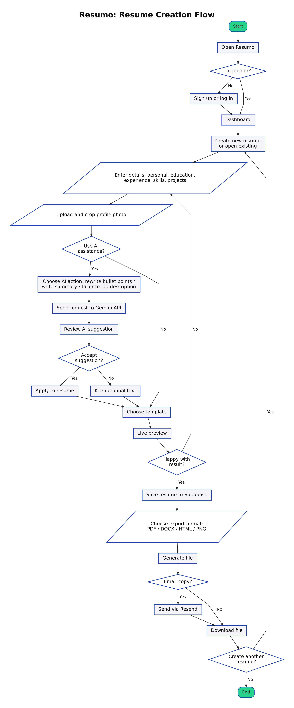
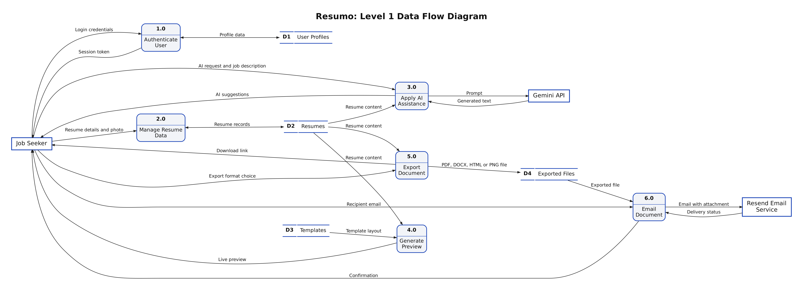
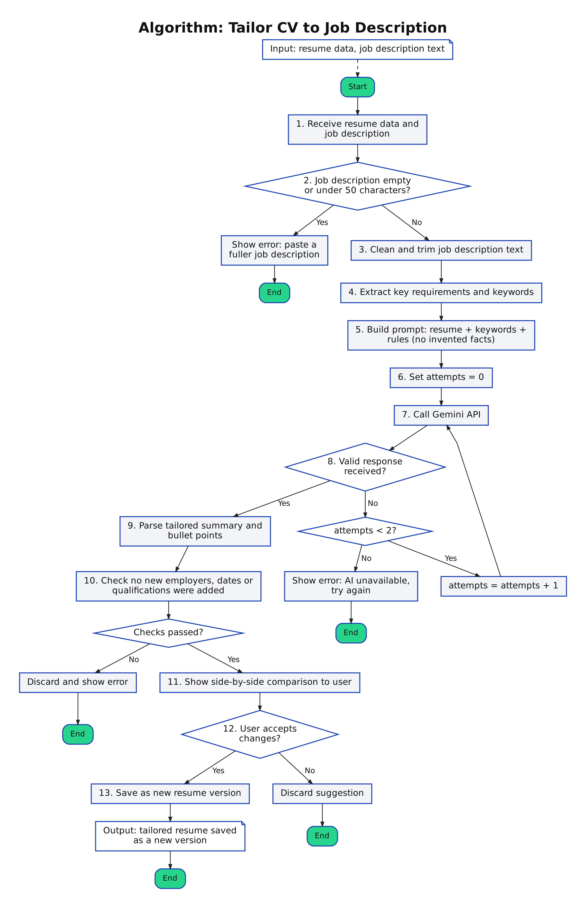
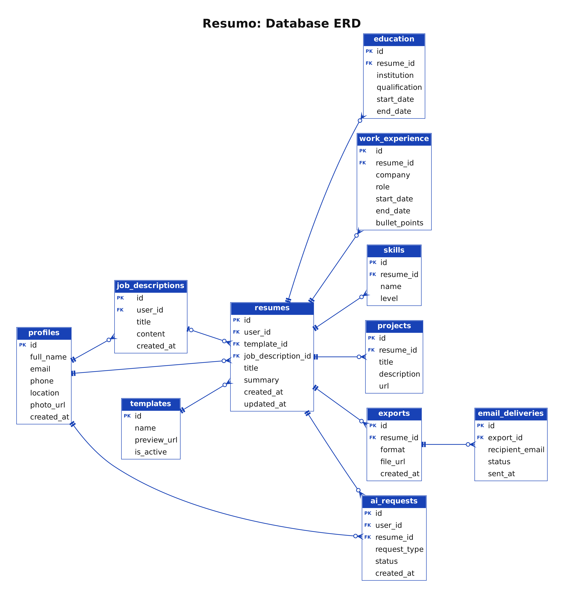

<div align="center">

<p align="center">
  <picture>
    <source media="(prefers-color-scheme: dark)" srcset="frontend/public/logos/resumo-logo-dark-bg.png">
    <source media="(prefers-color-scheme: light)" srcset="frontend/public/logos/resumo-logo-color.png">
    
  </picture>
</p>

**Build a polished, professional resume in minutes, with a little help from AI.**

[Live Demo](#) &nbsp;|&nbsp; [Report a Bug](../../issues) &nbsp;|&nbsp; [Request a Feature](../../issues)


</div>

---

## About

Resumo is a web-based resume and CV builder. Users enter their details once and Resumo turns them into a clean, visually appealing document with icons and a profile photo, ready to export in several formats. Built-in AI helps users improve their wording, write a professional summary, and tailor their CV to a specific job description.

Resumo is delivered as a fully deployed, installable Progressive Web App (PWA).

**Project status:** In development (started 1 November 2026)

## The Story Behind the Name

Resumo is a blend of two ideas: **resume** and **mo**, short for "more."

Every job seeker learns the same lesson sooner or later: one resume is never enough. A software role calls for a different story than a marketing role, and even two similar jobs deserve a CV shaped around what each employer is actually asking for. Rewriting from scratch every time is slow, and sending the same document everywhere is a missed chance.

Resumo is built around that idea. It is a platform for making more resumes: more versions, more tailored, more polished, in less time. Enter your details once, and Resumo helps you shape them into as many resumes as your job search needs.

More resumes, more opportunities. That is the "mo" in Resumo.

## Features

- **Guided input forms** for personal details, education, experience, skills, and projects
- **Live preview** that updates as you type
- **Visually appealing templates** with icons and a profile image
- **Image upload and crop** for the profile photo
- **Multiple export formats:** PDF, DOCX, HTML, and PNG
- **AI writing assistance:**
  - Rewrite weak bullet points into stronger, action-focused ones
  - Generate a professional summary from your details
  - Tailor your CV to a pasted job description
- **User accounts** to save and edit resumes (Supabase Auth)
- **Email delivery** of finished documents (Resend)
- **Installable PWA** that works on desktop and mobile

## Diagrams

The diagrams below describe how Resumo works. Click any image to open the full-size version.

### Flowchart

The user journey from login to exporting and emailing a finished resume.

<p align="center">
  <a href="docs/diagrams/01_flowchart.png">
    
  </a>
</p>

### Data Flow Diagram

Level 1 data flow between the job seeker, the six core processes, the four data stores, and the external services (Gemini API and Resend).

<p align="center">
  <a href="docs/diagrams/02_data_flow_diagram.png">
    
  </a>
</p>

### Algorithm: Tailor CV to Job Description

How Resumo uses the Gemini API to tailor a resume to a pasted job description, including validation, retries, and a check that no facts are invented.

<p align="center">
  <a href="docs/diagrams/03_algorithm.png">
    
  </a>
</p>

### Database ERD

The database structure for profiles, resumes, resume sections, exports, email deliveries, and AI requests.

<p align="center">
  <a href="docs/diagrams/04_database_erd.png">
    
  </a>
</p>

## Tech Stack

| Area | Technologies |
|---|---|
| Front end | JavaScript, React, Vite, Tailwind CSS, Lucide Icons, Google Fonts |
| Backend | Django REST Framework |
| Database, auth, storage | Supabase |
| Email | Resend |
| Document export | Puppeteer, WeasyPrint, python-docx |
| AI | Gemini API |
| Testing | Vitest, Playwright, pytest |
| DevOps | GitHub, GitHub Actions |
| Hosting | Vercel (front end), DigitalOcean (backend), Namecheap (domain) |

## Getting Started

### Prerequisites

- Node.js 20.19 or later
- Python 3.10 or later
- A Supabase project
- API keys for Resend and the AI provider

### Installation

1. **Clone the repository**

   ```bash
   git clone https://github.com/<your-username>/resumo.git
   cd resumo
   ```

2. **Install front end dependencies**

   ```bash
   cd frontend
   npm install
   ```

3. **Install backend dependencies**

   ```bash
   cd ../backend
   python -m venv venv
   source venv/bin/activate   # On Windows: venv\Scripts\activate
   pip install -r requirements.txt
   ```

4. **Set up environment variables**

   Create a `.env` file in each of the `frontend` and `backend` folders. Use the variable names below as a guide.

   ```env
   # frontend/.env
   VITE_SUPABASE_URL=your_supabase_project_url
   VITE_SUPABASE_ANON_KEY=your_supabase_anon_key
   VITE_API_URL=http://localhost:8000

   # backend/.env
   SUPABASE_URL=your_supabase_project_url
   SUPABASE_SERVICE_KEY=your_supabase_service_key
   RESEND_API_KEY=your_resend_api_key
   GEMINI_API_KEY=your_gemini_api_key
   ```

   Never commit `.env` files. They are listed in `.gitignore`.

### Running Locally

Start the backend:

```bash
cd backend
python manage.py runserver
```

Start the front end in a second terminal:

```bash
cd frontend
npm run dev
```

The app will be available at `http://localhost:5173`.

## Testing

```bash
# Front end unit tests
cd frontend
npm run test

# End-to-end tests
npx playwright test

# Backend tests
cd backend
pytest
```

Tests run automatically on every push and pull request through GitHub Actions. AI responses are mocked in tests so they stay fast and free.

## Deployment

- **Front end:** deployed on Vercel
- **Backend:** deployed on DigitalOcean
- **Database and auth:** Supabase
- **Domain:** registered through Namecheap

## Screenshots

_Screenshots will be added once the first version is deployed._

## Brand Assets

All logos are in `frontend/public/logos/`.

| File | Description | Best used on |
|---|---|---|
| resumo-logo-color.png | Blue and green wordmark | Light backgrounds |
| resumo-logo-dark-bg.png | White and green wordmark | Dark or colored backgrounds, such as the navbar |
| resumo-logo-black.png | All-black wordmark | Plain light backgrounds and print |
| resumo-logo-white.png | All-white wordmark | Dark backgrounds, such as the footer |
| resumo-badge.png | Wordmark on a blue badge | Social previews and avatars |

Brand colors: blue `#1842B6` and green `#26D48C`.

## Authors

| Name | GitHub |
|---|---|
| Chishibe Kabwe | [@chishibekabwe7](https://github.com/chishibekabwe7) |
| Emmanuel Mwape | [@your-github-username](https://github.com/your-github-username) |

## License

Released under the MIT License. See the [LICENSE](LICENSE) file for details.

See [THIRD_PARTY_NOTICES.md](THIRD_PARTY_NOTICES.md) for third-party notices.
